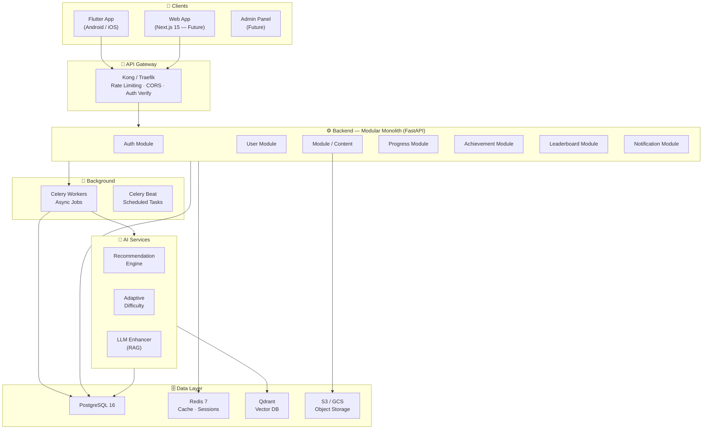
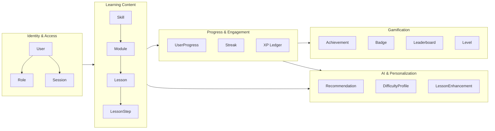
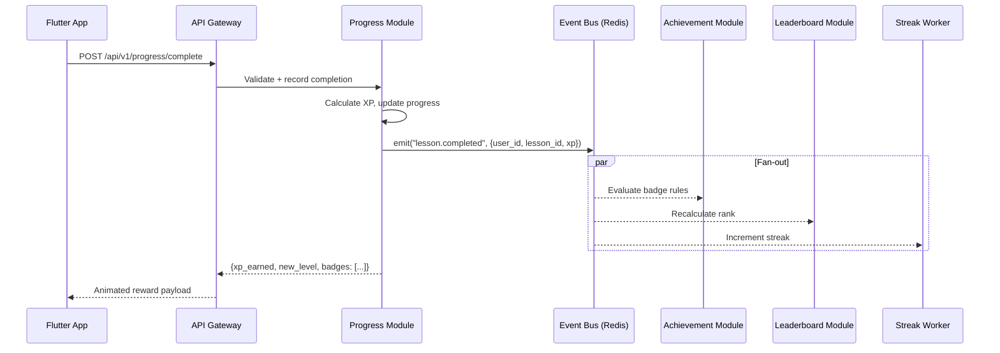

# 01 — System Architecture

> Pathly: Gamified Module-Based Learning Platform

---

## High-Level Architecture

## Architecture Decisions

| # | Decision | Choice | Rationale |
|---|---|---|---|
| ADR-001 | Backend Language | **Python 3.12 + FastAPI** | Best AI/ML ecosystem, async-native, Pydantic v2 |
| ADR-002 | Architecture Style | **Modular Monolith → Microservices** | Clear domain boundaries now; split later at scale |
| ADR-003 | API Style | **REST + OpenAPI 3.1** | Universal tooling, code generation, client SDKs |
| ADR-004 | State Management | **Riverpod 2.x** | Compile-safe, testable, code-gen friendly |
| ADR-005 | Primary DB | **PostgreSQL 16** | JSONB for content, FTS, CTEs for analytics |
| ADR-006 | Cache Layer | **Redis 7** | Sorted sets for leaderboard, pub/sub for events |
| ADR-007 | Vector DB | **Qdrant** | Purpose-built, gRPC, K8s-native |
| ADR-008 | Background Jobs | **Celery + Redis broker** | Battle-tested, integrates with FastAPI |

---

## Domain Model — Bounded Contexts (DDD)

### Aggregate Roots

| Aggregate | Owns | Invariants |
|---|---|---|
| **User** | profile, settings, auth_tokens | email unique, password hashed |
| **Skill** | modules → lessons → steps | ordering enforced, prerequisites |
| **UserProgress** | step completions, XP earned | idempotent completion, no duplicate XP |
| **Achievement** | badge rules, unlock conditions | rule engine evaluates on events |
| **Leaderboard** | rankings, decay scores | time-windowed, periodic recalc |

---

## Communication Patterns

| Pattern | Technology | Use Case |
|---|---|---|
| Synchronous REST | HTTP/JSON | CRUD, auth, lesson fetch |
| Async Events | Redis Pub/Sub | Progress → achievements, streak, leaderboard |
| Background Jobs | Celery | AI recs, batch analytics, notifications |
| Scheduled Tasks | Celery Beat | Streak expiry, leaderboard decay, daily digests |

### Event Flow: Lesson Completion

### Event Catalog

| Event | Publisher | Consumers |
|---|---|---|
| `user.registered` | Auth | User, Notification, Achievement |
| `lesson.completed` | Progress | Achievement, Leaderboard, Streak, Analytics |
| `streak.broken` | Streak Worker | Notification, Leaderboard |
| `badge.unlocked` | Achievement | Notification, User |
| `level.up` | Progress | Notification, Achievement |
| `xp.earned` | Progress | Leaderboard |
