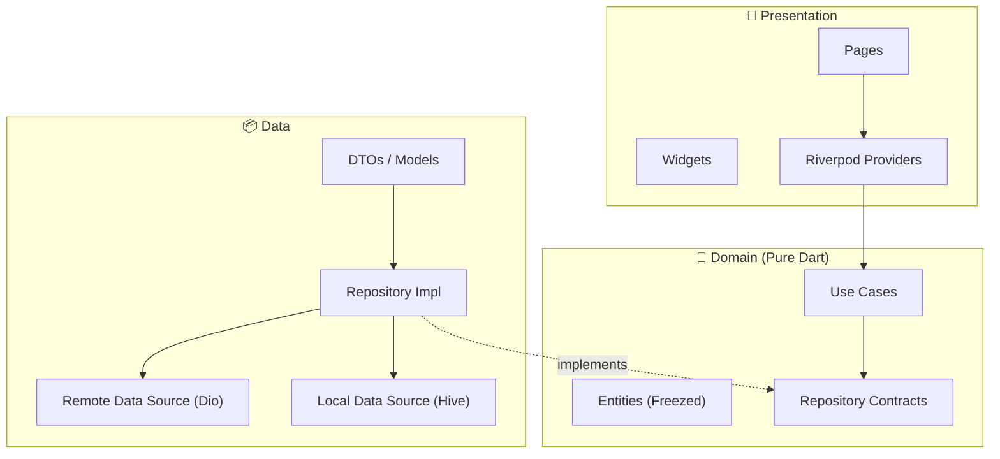

# 02 — Flutter Frontend Architecture

> Clean Architecture · Feature-First · Riverpod · Dart 3

---

## Technology Stack

| Layer | Technology | Purpose |
|---|---|---|
| Framework | Flutter 3.x / Dart 3 | Cross-platform UI |
| State | Riverpod 2.x + code_gen | Compile-safe, testable state |
| Navigation | GoRouter | Declarative, deep-link support |
| Networking | Dio + Retrofit | HTTP client + code-gen API layer |
| Models | Freezed + json_serializable | Immutable models, union types |
| Local Storage | Hive (or Isar) | Offline cache, user prefs |
| Auth | Firebase Auth | Google/Apple SSO, email/pw, phone |
| DI | Riverpod (built-in) | No separate DI package needed |
| Analytics | Firebase Analytics | Event tracking |
| Animations | Rive / Lottie | Gamification reward animations |

---

## Folder Structure

```
app/
├── lib/
│   ├── main.dart                           # App entry point
│   ├── app.dart                            # MaterialApp.router setup
│   │
│   ├── core/                               # Cross-cutting concerns
│   │   ├── constants/
│   │   │   ├── app_constants.dart          # API URLs, timeouts, limits
│   │   │   └── storage_keys.dart           # Hive box keys
│   │   ├── di/
│   │   │   └── providers.dart              # Global Riverpod providers
│   │   ├── error/
│   │   │   ├── failures.dart               # Domain failure types (Freezed)
│   │   │   └── exceptions.dart             # Infrastructure exceptions
│   │   ├── network/
│   │   │   ├── dio_client.dart             # Dio instance + interceptors
│   │   │   ├── auth_interceptor.dart       # JWT token injection
│   │   │   └── connectivity.dart           # Online/offline detection
│   │   ├── router/
│   │   │   ├── app_router.dart             # GoRouter config
│   │   │   ├── route_names.dart            # Named routes
│   │   │   └── guards.dart                 # Auth guards, onboarding check
│   │   ├── theme/
│   │   │   ├── app_theme.dart              # ThemeData (light + dark)
│   │   │   ├── app_colors.dart             # Color palette tokens
│   │   │   ├── app_text_styles.dart        # Typography scale
│   │   │   ├── app_spacing.dart            # Spacing constants
│   │   │   └── theme_extensions.dart       # Custom ThemeExtension<T>
│   │   └── utils/
│   │       ├── date_utils.dart
│   │       ├── validators.dart
│   │       └── logger.dart
│   │
│   ├── features/                           # Feature modules (domain-first)
│   │   ├── auth/
│   │   │   ├── data/
│   │   │   │   ├── datasources/
│   │   │   │   │   ├── auth_remote_ds.dart
│   │   │   │   │   └── auth_local_ds.dart
│   │   │   │   ├── models/
│   │   │   │   │   └── user_model.dart     # DTO (Freezed + json)
│   │   │   │   └── repositories/
│   │   │   │       └── auth_repo_impl.dart
│   │   │   ├── domain/
│   │   │   │   ├── entities/
│   │   │   │   │   └── user.dart           # Domain entity (Freezed)
│   │   │   │   ├── repositories/
│   │   │   │   │   └── auth_repo.dart      # Abstract contract
│   │   │   │   └── usecases/
│   │   │   │       ├── login.dart
│   │   │   │       ├── register.dart
│   │   │   │       └── logout.dart
│   │   │   └── presentation/
│   │   │       ├── providers/
│   │   │       │   └── auth_provider.dart  # Riverpod notifiers
│   │   │       ├── pages/
│   │   │       │   ├── login_page.dart
│   │   │       │   ├── register_page.dart
│   │   │       │   └── onboarding_page.dart
│   │   │       └── widgets/
│   │   │           ├── social_login_button.dart
│   │   │           └── auth_form.dart
│   │   │
│   │   ├── dashboard/                      # Home screen with skill cards
│   │   │   ├── data/ ...
│   │   │   ├── domain/ ...
│   │   │   └── presentation/
│   │   │       ├── pages/
│   │   │       │   └── dashboard_page.dart
│   │   │       └── widgets/
│   │   │           ├── skill_card.dart
│   │   │           ├── streak_banner.dart
│   │   │           ├── daily_goal_ring.dart
│   │   │           └── recommended_section.dart
│   │   │
│   │   ├── modules/                        # Skill → Module browsing
│   │   │   ├── data/ ...
│   │   │   ├── domain/ ...
│   │   │   └── presentation/
│   │   │       ├── pages/
│   │   │       │   ├── skill_detail_page.dart
│   │   │       │   └── module_list_page.dart
│   │   │       └── widgets/
│   │   │           ├── module_card.dart
│   │   │           └── progress_ring.dart
│   │   │
│   │   ├── lesson/                         # Step-by-step lesson player
│   │   │   ├── data/ ...
│   │   │   ├── domain/ ...
│   │   │   └── presentation/
│   │   │       ├── pages/
│   │   │       │   └── lesson_player_page.dart
│   │   │       └── widgets/
│   │   │           ├── step_renderer.dart   # Renders text/quiz/code/media
│   │   │           ├── quiz_widget.dart
│   │   │           ├── code_editor.dart
│   │   │           ├── progress_bar.dart
│   │   │           └── xp_reward_animation.dart
│   │   │
│   │   ├── progress/                       # User progress & stats
│   │   │   ├── data/ ...
│   │   │   ├── domain/ ...
│   │   │   └── presentation/
│   │   │       ├── pages/
│   │   │       │   └── progress_page.dart
│   │   │       └── widgets/
│   │   │           ├── progress_chart.dart
│   │   │           ├── skill_progress_list.dart
│   │   │           └── weekly_heatmap.dart
│   │   │
│   │   ├── achievements/                   # Badges & achievements
│   │   │   ├── data/ ...
│   │   │   ├── domain/ ...
│   │   │   └── presentation/
│   │   │       ├── pages/
│   │   │       │   └── achievements_page.dart
│   │   │       └── widgets/
│   │   │           ├── badge_grid.dart
│   │   │           └── badge_detail_sheet.dart
│   │   │
│   │   ├── leaderboard/                    # Rankings
│   │   │   ├── data/ ...
│   │   │   ├── domain/ ...
│   │   │   └── presentation/
│   │   │       ├── pages/
│   │   │       │   └── leaderboard_page.dart
│   │   │       └── widgets/
│   │   │           ├── rank_card.dart
│   │   │           └── league_banner.dart
│   │   │
│   │   └── profile/                        # User profile & settings
│   │       ├── data/ ...
│   │       ├── domain/ ...
│   │       └── presentation/ ...
│   │
│   ├── shared/                             # Reusable cross-feature code
│   │   ├── widgets/
│   │   │   ├── pathly_button.dart          # Primary button
│   │   │   ├── pathly_card.dart            # Base card
│   │   │   ├── pathly_shimmer.dart         # Loading skeleton
│   │   │   ├── pathly_snackbar.dart        # Feedback toasts
│   │   │   ├── adaptive_scaffold.dart      # Phone/tablet layout
│   │   │   └── animated_counter.dart       # XP/streak counters
│   │   ├── extensions/
│   │   │   ├── context_ext.dart            # BuildContext helpers
│   │   │   ├── string_ext.dart
│   │   │   └── datetime_ext.dart
│   │   └── mixins/
│   │       └── loading_mixin.dart
│   │
│   └── infrastructure/                     # Cross-feature infra
│       ├── local_storage/
│       │   └── hive_service.dart
│       ├── analytics/
│       │   └── analytics_service.dart
│       └── notifications/
│           └── push_notification_service.dart
│
├── test/
│   ├── features/
│   │   ├── auth/
│   │   │   ├── domain/usecases/login_test.dart
│   │   │   └── data/repositories/auth_repo_test.dart
│   │   └── ...
│   ├── shared/widgets/
│   └── core/
│
├── integration_test/
│   ├── auth_flow_test.dart
│   └── lesson_completion_test.dart
│
├── pubspec.yaml
├── analysis_options.yaml
└── l10n/                                   # Localization
    ├── app_en.arb
    └── app_hi.arb
```

---

## Clean Architecture Layers



### Dependency Rule
- **Domain** depends on nothing (pure Dart)
- **Data** depends on Domain (implements contracts)
- **Presentation** depends on Domain (through use cases)
- **No layer may import from a sibling feature** — use shared/ or events

---

## Key Design Patterns

### 1. Feature Module Template
Every feature follows this exact structure:
```
feature_name/
├── data/
│   ├── datasources/       # Remote & local data sources
│   ├── models/             # DTOs with Freezed + json_serializable
│   └── repositories/       # Implements domain contracts
├── domain/
│   ├── entities/           # Business objects (Freezed, no annotations)
│   ├── repositories/       # Abstract classes (contracts)
│   └── usecases/           # Single-responsibility use cases
└── presentation/
    ├── providers/          # Riverpod AsyncNotifier / Notifier
    ├── pages/              # Full screen views
    └── widgets/            # Feature-specific widgets
```

### 2. Use Case Pattern
```dart
// domain/usecases/complete_lesson.dart
class CompleteLesson {
  final ProgressRepository _repo;
  const CompleteLesson(this._repo);

  Future<Either<Failure, CompletionResult>> call(CompleteLessonParams params) {
    return _repo.completeLesson(params.lessonId, params.stepResults);
  }
}
```

### 3. Riverpod Provider Pattern
```dart
// presentation/providers/lesson_provider.dart
@riverpod
class LessonNotifier extends _$LessonNotifier {
  @override
  FutureOr<LessonState> build(String lessonId) async {
    final lesson = await ref.read(getLessonProvider).call(lessonId);
    return lesson.fold(
      (failure) => throw failure,
      (data) => LessonState.loaded(data),
    );
  }

  Future<void> completeStep(String stepId, StepResult result) async { ... }
}
```

### 4. Error Handling (Either Pattern)
```dart
// core/error/failures.dart
@freezed
sealed class Failure with _$Failure {
  const factory Failure.network({String? message}) = NetworkFailure;
  const factory Failure.server({required int code, String? message}) = ServerFailure;
  const factory Failure.cache({String? message}) = CacheFailure;
  const factory Failure.auth({String? message}) = AuthFailure;
}
```

---

## UI Design System

### Token Structure
```dart
// core/theme/app_colors.dart
abstract class AppColors {
  // Primary
  static const primary     = Color(0xFF6C5CE7);  // Purple
  static const primaryDark = Color(0xFF5A4BD1);
  static const accent      = Color(0xFF00D2D3);  // Teal

  // Gamification
  static const xpGold      = Color(0xFFFFD700);
  static const streakOrange = Color(0xFFFF6B35);
  static const levelGreen   = Color(0xFF2ECC71);

  // Semantic
  static const success = Color(0xFF27AE60);
  static const error   = Color(0xFFE74C3C);
  static const warning = Color(0xFFF39C12);

  // Surface (Dark Mode)
  static const surfaceDark   = Color(0xFF1A1A2E);
  static const cardDark      = Color(0xFF16213E);
  static const backgroundDark = Color(0xFF0F3460);
}
```

### Adaptive Layout
```dart
// shared/widgets/adaptive_scaffold.dart
class AdaptiveScaffold extends StatelessWidget {
  // Breakpoints: phone < 600dp < tablet < 840dp < desktop
  // Phone: single column, bottom nav
  // Tablet: two-pane, rail nav
  // Desktop (future): three-pane, side nav
}
```

### Accessibility
- All interactive elements have `Semantics` labels
- Min touch targets: 48×48dp
- Color contrast ≥ 4.5:1 (AA compliant)
- Screen reader tested with TalkBack + VoiceOver
- Dynamic font scaling supported
