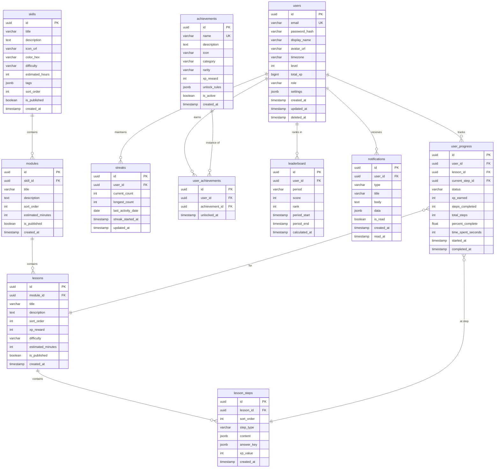

# 04 — Database Design

> PostgreSQL 16 · Alembic Migrations · Query Optimization

---

## Entity-Relationship Diagram



---

## Schema DDL (Key Tables)

```sql
-- Enable extensions
CREATE EXTENSION IF NOT EXISTS "uuid-ossp";
CREATE EXTENSION IF NOT EXISTS "pg_trgm";    -- Fuzzy text search

-- USERS
CREATE TABLE users (
    id              UUID PRIMARY KEY DEFAULT uuid_generate_v4(),
    email           VARCHAR(255) NOT NULL UNIQUE,
    password_hash   VARCHAR(255) NOT NULL,
    display_name    VARCHAR(100) NOT NULL,
    avatar_url      VARCHAR(500),
    timezone        VARCHAR(50) DEFAULT 'UTC',
    level           INT NOT NULL DEFAULT 1,
    total_xp        BIGINT NOT NULL DEFAULT 0,
    role            VARCHAR(20) NOT NULL DEFAULT 'learner'
                    CHECK (role IN ('learner', 'creator', 'admin')),
    settings        JSONB DEFAULT '{}',
    created_at      TIMESTAMPTZ NOT NULL DEFAULT NOW(),
    updated_at      TIMESTAMPTZ NOT NULL DEFAULT NOW(),
    deleted_at      TIMESTAMPTZ  -- Soft delete
);

CREATE INDEX idx_users_email ON users (email);
CREATE INDEX idx_users_role ON users (role) WHERE deleted_at IS NULL;

-- SKILLS (Learning Tracks)
CREATE TABLE skills (
    id              UUID PRIMARY KEY DEFAULT uuid_generate_v4(),
    title           VARCHAR(200) NOT NULL,
    description     TEXT,
    icon_url        VARCHAR(500),
    color_hex       VARCHAR(7),
    difficulty      VARCHAR(20) CHECK (difficulty IN ('beginner', 'intermediate', 'advanced')),
    estimated_hours INT,
    tags            JSONB DEFAULT '[]',
    sort_order      INT NOT NULL DEFAULT 0,
    is_published    BOOLEAN NOT NULL DEFAULT false,
    created_at      TIMESTAMPTZ NOT NULL DEFAULT NOW()
);

CREATE INDEX idx_skills_published ON skills (sort_order) WHERE is_published = true;

-- MODULES
CREATE TABLE modules (
    id              UUID PRIMARY KEY DEFAULT uuid_generate_v4(),
    skill_id        UUID NOT NULL REFERENCES skills(id) ON DELETE CASCADE,
    title           VARCHAR(200) NOT NULL,
    description     TEXT,
    sort_order      INT NOT NULL DEFAULT 0,
    estimated_minutes INT,
    is_published    BOOLEAN NOT NULL DEFAULT false,
    created_at      TIMESTAMPTZ NOT NULL DEFAULT NOW()
);

CREATE INDEX idx_modules_skill ON modules (skill_id, sort_order) WHERE is_published = true;

-- LESSONS
CREATE TABLE lessons (
    id              UUID PRIMARY KEY DEFAULT uuid_generate_v4(),
    module_id       UUID NOT NULL REFERENCES modules(id) ON DELETE CASCADE,
    title           VARCHAR(200) NOT NULL,
    description     TEXT,
    sort_order      INT NOT NULL DEFAULT 0,
    xp_reward       INT NOT NULL DEFAULT 10,
    difficulty      VARCHAR(20) DEFAULT 'normal',
    estimated_minutes INT,
    is_published    BOOLEAN NOT NULL DEFAULT false,
    created_at      TIMESTAMPTZ NOT NULL DEFAULT NOW()
);

CREATE INDEX idx_lessons_module ON lessons (module_id, sort_order) WHERE is_published = true;

-- LESSON STEPS
CREATE TABLE lesson_steps (
    id              UUID PRIMARY KEY DEFAULT uuid_generate_v4(),
    lesson_id       UUID NOT NULL REFERENCES lessons(id) ON DELETE CASCADE,
    sort_order      INT NOT NULL DEFAULT 0,
    step_type       VARCHAR(30) NOT NULL
                    CHECK (step_type IN ('text', 'quiz_mcq', 'quiz_fill', 'code_editor', 'media', 'interactive')),
    content         JSONB NOT NULL,
    answer_key      JSONB,           -- Correct answers for quiz types
    xp_value        INT NOT NULL DEFAULT 5,
    created_at      TIMESTAMPTZ NOT NULL DEFAULT NOW()
);

CREATE INDEX idx_steps_lesson ON lesson_steps (lesson_id, sort_order);

-- USER PROGRESS
CREATE TABLE user_progress (
    id                UUID PRIMARY KEY DEFAULT uuid_generate_v4(),
    user_id           UUID NOT NULL REFERENCES users(id) ON DELETE CASCADE,
    lesson_id         UUID NOT NULL REFERENCES lessons(id) ON DELETE CASCADE,
    current_step_id   UUID REFERENCES lesson_steps(id),
    status            VARCHAR(20) NOT NULL DEFAULT 'not_started'
                      CHECK (status IN ('not_started', 'in_progress', 'completed')),
    xp_earned         INT NOT NULL DEFAULT 0,
    steps_completed   INT NOT NULL DEFAULT 0,
    total_steps       INT NOT NULL DEFAULT 0,
    percent_complete  REAL NOT NULL DEFAULT 0.0,
    time_spent_seconds INT NOT NULL DEFAULT 0,
    started_at        TIMESTAMPTZ,
    completed_at      TIMESTAMPTZ,

    UNIQUE (user_id, lesson_id)  -- One progress record per user per lesson
);

CREATE INDEX idx_progress_user ON user_progress (user_id, status);
CREATE INDEX idx_progress_lesson ON user_progress (lesson_id);
CREATE INDEX idx_progress_completed ON user_progress (user_id, completed_at DESC)
    WHERE status = 'completed';

-- STREAKS
CREATE TABLE streaks (
    id                UUID PRIMARY KEY DEFAULT uuid_generate_v4(),
    user_id           UUID NOT NULL UNIQUE REFERENCES users(id) ON DELETE CASCADE,
    current_count     INT NOT NULL DEFAULT 0,
    longest_count     INT NOT NULL DEFAULT 0,
    last_activity_date DATE,
    streak_started_at TIMESTAMPTZ,
    updated_at        TIMESTAMPTZ NOT NULL DEFAULT NOW()
);

-- ACHIEVEMENTS
CREATE TABLE achievements (
    id              UUID PRIMARY KEY DEFAULT uuid_generate_v4(),
    name            VARCHAR(100) NOT NULL UNIQUE,
    description     TEXT,
    icon            VARCHAR(10),      -- Emoji or icon code
    category        VARCHAR(30) CHECK (category IN ('learning', 'streak', 'social', 'milestone', 'special')),
    rarity          VARCHAR(20) CHECK (rarity IN ('common', 'uncommon', 'rare', 'epic', 'legendary')),
    xp_reward       INT NOT NULL DEFAULT 0,
    unlock_rules    JSONB NOT NULL,   -- {"type": "lessons_completed", "threshold": 10}
    is_active       BOOLEAN NOT NULL DEFAULT true,
    created_at      TIMESTAMPTZ NOT NULL DEFAULT NOW()
);

-- USER → ACHIEVEMENTS (many-to-many)
CREATE TABLE user_achievements (
    id              UUID PRIMARY KEY DEFAULT uuid_generate_v4(),
    user_id         UUID NOT NULL REFERENCES users(id) ON DELETE CASCADE,
    achievement_id  UUID NOT NULL REFERENCES achievements(id) ON DELETE CASCADE,
    unlocked_at     TIMESTAMPTZ NOT NULL DEFAULT NOW(),

    UNIQUE (user_id, achievement_id)
);

CREATE INDEX idx_user_achievements_user ON user_achievements (user_id, unlocked_at DESC);

-- LEADERBOARD (materialized / cached)
CREATE TABLE leaderboard (
    id              UUID PRIMARY KEY DEFAULT uuid_generate_v4(),
    user_id         UUID NOT NULL REFERENCES users(id) ON DELETE CASCADE,
    period          VARCHAR(20) NOT NULL CHECK (period IN ('weekly', 'monthly', 'alltime')),
    score           INT NOT NULL DEFAULT 0,
    rank            INT,
    period_start    TIMESTAMPTZ NOT NULL,
    period_end      TIMESTAMPTZ NOT NULL,
    calculated_at   TIMESTAMPTZ NOT NULL DEFAULT NOW(),

    UNIQUE (user_id, period, period_start)
);

CREATE INDEX idx_leaderboard_rank ON leaderboard (period, period_start, score DESC);

-- NOTIFICATIONS
CREATE TABLE notifications (
    id              UUID PRIMARY KEY DEFAULT uuid_generate_v4(),
    user_id         UUID NOT NULL REFERENCES users(id) ON DELETE CASCADE,
    type            VARCHAR(30) NOT NULL,
    title           VARCHAR(200) NOT NULL,
    body            TEXT,
    data            JSONB DEFAULT '{}',
    is_read         BOOLEAN NOT NULL DEFAULT false,
    created_at      TIMESTAMPTZ NOT NULL DEFAULT NOW(),
    read_at         TIMESTAMPTZ
);

CREATE INDEX idx_notifications_user ON notifications (user_id, is_read, created_at DESC);
CREATE INDEX idx_notifications_unread ON notifications (user_id, created_at DESC)
    WHERE is_read = false;
```

---

## Query Optimization Strategy

| Query | Optimization |
|---|---|
| User's skill progress | Composite index `(user_id, status)` on `user_progress` |
| Leaderboard ranking | Pre-computed in `leaderboard` table, refreshed by Celery Beat |
| Unread notifications | Partial index `WHERE is_read = false` |
| Published content | Partial indexes `WHERE is_published = true` |
| Streak check | Unique index on `streaks.user_id` — single row per user |
| Module ordering | Composite `(skill_id, sort_order)` for ordered fetching |
| Full-text search | `pg_trgm` index on `skills.title` + `lessons.title` |
| Soft-deleted users | Partial indexes exclude `WHERE deleted_at IS NULL` |

### Materialized Views (Analytics)
```sql
-- Daily active users
CREATE MATERIALIZED VIEW mv_daily_active AS
SELECT DATE(completed_at) AS day, COUNT(DISTINCT user_id) AS dau
FROM user_progress
WHERE completed_at IS NOT NULL
GROUP BY DATE(completed_at);

-- Module popularity
CREATE MATERIALIZED VIEW mv_module_popularity AS
SELECT m.id, m.title, COUNT(up.id) AS completions
FROM modules m
JOIN lessons l ON l.module_id = m.id
JOIN user_progress up ON up.lesson_id = l.id AND up.status = 'completed'
GROUP BY m.id, m.title
ORDER BY completions DESC;
```
