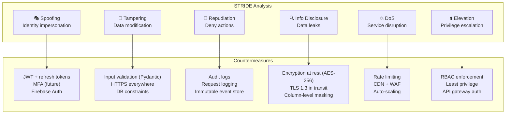

# 06 — Security Checklist & Threat Model

> OWASP Top 10 · STRIDE · Secure-by-Design

---

## STRIDE Threat Model



---

## OWASP Top 10 Compliance Checklist

| # | Vulnerability | Mitigation | Status |
|---|---|---|---|
| A01 | **Broken Access Control** | RBAC on every endpoint, row-level security, API gateway auth verification | 🔲 |
| A02 | **Cryptographic Failures** | bcrypt for passwords, AES-256 at rest, TLS 1.3 in transit, no secrets in code | 🔲 |
| A03 | **Injection** | Pydantic input validation, SQLAlchemy ORM (parameterized queries), no raw SQL | 🔲 |
| A04 | **Insecure Design** | Threat modeling (this doc), clean architecture, defense in depth | 🔲 |
| A05 | **Security Misconfiguration** | Hardened Docker images, no default creds, security headers, CORS whitelist | 🔲 |
| A06 | **Vulnerable Components** | Trivy scanning, Dependabot, SBOM generation, pinned versions | 🔲 |
| A07 | **Auth Failures** | JWT short-lived (15min), refresh rotation, brute-force lockout, Firebase Auth | 🔲 |
| A08 | **Software Integrity** | Signed Docker images, checksums, CI pipeline integrity, code review required | 🔲 |
| A09 | **Logging & Monitoring** | Structured logging (JSON), ELK stack, alert on anomalies, audit trail | 🔲 |
| A10 | **SSRF** | URL validation, no user-controlled URLs to internal services, allowlist external APIs | 🔲 |

---

## Authentication & Authorization

### Token Architecture
```
┌─────────────────────────────────────────┐
│  Access Token (JWT)                      │
│  ├─ Lifetime: 15 minutes                │
│  ├─ Contains: user_id, role, email      │
│  ├─ Signed: RS256 (asymmetric)          │
│  └─ Validated: API gateway + each service│
├─────────────────────────────────────────┤
│  Refresh Token                           │
│  ├─ Lifetime: 30 days                   │
│  ├─ Stored: HTTP-only secure cookie     │
│  ├─ Single use (rotation on refresh)    │
│  └─ Revocable: stored in Redis          │
└─────────────────────────────────────────┘
```

### RBAC Matrix

| Endpoint | Learner | Creator | Admin |
|---|---|---|---|
| GET /skills | ✅ | ✅ | ✅ |
| POST /skills | ❌ | ✅ | ✅ |
| PUT /skills/:id | ❌ | ✅ (own) | ✅ |
| DELETE /skills/:id | ❌ | ❌ | ✅ |
| GET /users | ❌ | ❌ | ✅ |
| POST /progress/complete | ✅ | ✅ | ✅ |
| GET /leaderboard | ✅ | ✅ | ✅ |
| POST /ai/explain | ✅ | ✅ | ✅ |
| GET /admin/* | ❌ | ❌ | ✅ |

---

## Security Headers

```python
# Applied via middleware
SECURITY_HEADERS = {
    "X-Content-Type-Options": "nosniff",
    "X-Frame-Options": "DENY",
    "X-XSS-Protection": "1; mode=block",
    "Strict-Transport-Security": "max-age=31536000; includeSubDomains",
    "Content-Security-Policy": "default-src 'self'",
    "Referrer-Policy": "strict-origin-when-cross-origin",
    "Permissions-Policy": "camera=(), microphone=(), geolocation=()",
}
```

---

## Input Validation Strategy

| Layer | Tool | What It Validates |
|---|---|---|
| API Gateway | Kong / rate limiting | Request size, rate, IP reputation |
| FastAPI | Pydantic V2 models | Schema, types, constraints, regex |
| ORM | SQLAlchemy | Parameterized queries, type coercion |
| Database | PostgreSQL CHECK | Data integrity, enums, ranges |

### Pydantic Example
```python
class RegisterRequest(BaseModel):
    email: EmailStr
    password: str = Field(min_length=8, max_length=128)
    display_name: str = Field(min_length=2, max_length=100, pattern=r"^[\w\s\-]+$")

    @field_validator("password")
    @classmethod
    def validate_password_strength(cls, v: str) -> str:
        if not re.search(r"[A-Z]", v): raise ValueError("Must contain uppercase")
        if not re.search(r"[0-9]", v): raise ValueError("Must contain digit")
        if not re.search(r"[!@#$%]", v): raise ValueError("Must contain special char")
        return v
```

---

## CI Security Pipeline

```yaml
security-checks:
  steps:
    - name: SAST (Bandit)         # Python static security
    - name: Trivy (Container)      # Image vulnerability scan
    - name: OWASP Dependency Check # Known CVEs in deps
    - name: Secret Scanner         # No hardcoded secrets
    - name: License Compliance     # OSS license audit
```

---

## Audit Logging

| Event | Data Captured |
|---|---|
| User login | user_id, IP, user_agent, timestamp, success/fail |
| Password change | user_id, timestamp |
| Role change | actor_id, target_user_id, old_role, new_role |
| Content CRUD | actor_id, entity_type, entity_id, action, diff |
| API errors (4xx/5xx) | endpoint, status, error, user_id, IP |

```python
# Structured audit log format (JSON)
{
    "timestamp": "2026-03-02T11:00:00Z",
    "event": "user.login",
    "actor_id": "uuid",
    "ip": "203.0.113.42",
    "user_agent": "PathlyApp/1.0 (Android)",
    "result": "success",
    "metadata": {}
}
```

---

## Data Protection

| Data | At Rest | In Transit | Retention |
|---|---|---|---|
| Passwords | bcrypt (work factor 12) | N/A (never sent) | Hashed forever |
| PII (email, name) | AES-256 (DB encryption) | TLS 1.3 | Until deletion |
| Tokens | Redis (encrypted volume) | TLS 1.3 | TTL-based |
| Analytics | PostgreSQL | TLS 1.3 | 2 years |
| Audit logs | Immutable (append-only) | TLS 1.3 | 5 years |
