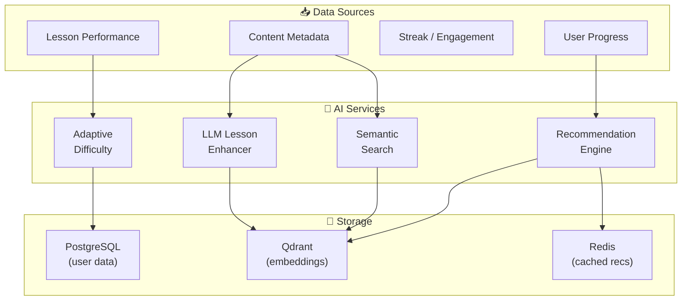
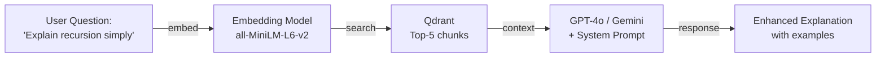

# 08 — AI & Personalization Architecture

> Recommendations · Adaptive Difficulty · RAG · LLM Enhancer

---

## AI Services Overview



---

## 1. Recommendation Engine

### Strategy: Hybrid Filtering

| Type | Signal | Weight |
|---|---|---|
| Collaborative | Users with similar progress patterns | 40% |
| Content-Based | Lesson content similarity (embeddings) | 35% |
| Knowledge-Gap | Skills the user hasn't started but prerequisites are met | 15% |
| Trending | Popular content this week | 10% |

### Architecture
```python
class RecommendationService:
    def get_recommendations(self, user_id: str, limit: int = 5) -> list[Recommendation]:
        # 1. Get user's completed lessons + performance
        user_history = self.progress_repo.get_history(user_id)

        # 2. Find similar users (collaborative)
        similar_users = self.find_similar_users(user_history)
        collab_recs = self.collab_filter(similar_users, user_history)

        # 3. Content-based: embed user profile → nearest lessons
        user_embedding = self.embed_user_profile(user_history)
        content_recs = self.qdrant.search(
            collection="lessons",
            query_vector=user_embedding,
            limit=20,
            filter={"lesson_id": {"$nin": user_history.completed_ids}}
        )

        # 4. Knowledge gap: unlocked but not started
        gap_recs = self.find_knowledge_gaps(user_id)

        # 5. Trending
        trending = self.get_trending_lessons(period="7d", limit=10)

        # 6. Blend with weights + deduplicate
        return self.blend_and_rank(
            collab_recs, content_recs, gap_recs, trending,
            weights=[0.4, 0.35, 0.15, 0.10],
            limit=limit
        )
```

### Embeddings Pipeline
```
Lesson content (title + description + step text)
    ↓
sentence-transformers/all-MiniLM-L6-v2  (384-dim)
    ↓
Qdrant collection: "lessons"
    ├── vector: [384 floats]
    ├── payload: {lesson_id, module_id, skill_id, difficulty, tags}
    └── indexed: skill_id, difficulty
```

### Caching
- Recommendations cached in Redis for 1 hour per user
- Cache invalidated on lesson completion
- Trending cached globally for 15 minutes

---

## 2. Adaptive Difficulty

### User Difficulty Profile
```python
@dataclass
class DifficultyProfile:
    user_id: str
    skill_scores: dict[str, float]   # skill_id → mastery (0.0–1.0)
    avg_accuracy: float               # Overall accuracy rate
    avg_time_ratio: float             # avg(actual_time / estimated_time)
    struggle_topics: list[str]        # Tags where accuracy < 60%
    strong_topics: list[str]          # Tags where accuracy > 90%
```

### Scaling Algorithm
```python
def select_difficulty(profile: DifficultyProfile, skill_id: str) -> str:
    mastery = profile.skill_scores.get(skill_id, 0.0)

    if mastery < 0.3:
        return "easy"       # Reinforce basics
    elif mastery < 0.6:
        return "normal"     # Progressive challenge
    elif mastery < 0.85:
        return "hard"       # Push boundaries
    else:
        return "expert"     # Mastery-level challenge

def adjust_after_lesson(profile: DifficultyProfile, result: LessonResult):
    """Bayesian update of mastery score after lesson completion."""
    skill_id = result.skill_id
    accuracy = result.correct_steps / result.total_steps
    current = profile.skill_scores.get(skill_id, 0.5)

    # Exponential moving average (alpha = 0.3)
    profile.skill_scores[skill_id] = current * 0.7 + accuracy * 0.3
```

### Zone of Proximal Development (ZPD)
Target: **70–85% accuracy** — challenging but not frustrating
- Below 70% → reduce difficulty for next lesson
- Above 85% → increase difficulty
- Track rolling 5-lesson average per skill

---

## 3. Streak Risk Detection (AI-Enhanced)

### ML Model (Future Enhancement)
```python
# Features for churn prediction
features = {
    "streak_length": 14,
    "avg_daily_xp_last_7d": 45,
    "days_since_last_lesson": 0,
    "weekend_activity_rate": 0.3,
    "time_of_day_preference": "evening",
    "lessons_last_7d": 5,
    "difficulty_trend": "increasing",
    "notification_response_rate": 0.6,
}

# Predict probability of streak break tomorrow
risk_score = streak_model.predict_proba(features)  # 0.0–1.0

# If > 0.7: trigger proactive notification
# If > 0.9: offer streak freeze
```

---

## 4. LLM-Based Lesson Enhancer

### RAG Architecture



### API Endpoint
```python
@router.post("/ai/explain")
async def explain_concept(
    request: ExplainRequest,
    user: User = Depends(get_current_user),
):
    # 1. Embed the question
    query_embedding = embedder.encode(request.question)

    # 2. Retrieve relevant lesson chunks
    chunks = await qdrant.search(
        collection="lesson_chunks",
        query_vector=query_embedding,
        limit=5,
    )

    # 3. Build context
    context = "\n\n".join([c.payload["text"] for c in chunks])

    # 4. Generate explanation
    response = await llm.generate(
        system_prompt=EXPLAIN_SYSTEM_PROMPT,
        user_prompt=f"Based on this context:\n{context}\n\nExplain: {request.question}",
        max_tokens=500,
        temperature=0.7,
    )

    return ExplainResponse(
        explanation=response.text,
        sources=[c.payload["lesson_id"] for c in chunks],
    )
```

### System Prompt
```
You are Pathly AI, a friendly learning assistant. Explain concepts clearly
using simple language, analogies, and examples. The user is at level {level}
studying {skill}. Adapt your explanation to their level. Use markdown formatting.
Keep explanations under 200 words unless the user asks for more detail.
```

---

## 5. Semantic Search

### Implementation
```python
@router.get("/search")
async def semantic_search(
    q: str = Query(min_length=2, max_length=200),
    limit: int = Query(default=10, le=50),
):
    # Hybrid search: vector similarity + keyword matching
    query_embedding = embedder.encode(q)

    # Vector search
    vector_results = await qdrant.search(
        collection="lessons",
        query_vector=query_embedding,
        limit=limit * 2,
    )

    # PostgreSQL full-text search (fallback + boost)
    keyword_results = await db.execute(
        select(Lesson)
        .where(Lesson.title.ilike(f"%{q}%"))
        .limit(limit)
    )

    # Merge & re-rank
    return merge_results(vector_results, keyword_results, limit)
```

---

## Technology Summary

| Component | Technology | Model/Config |
|---|---|---|
| Embeddings | sentence-transformers | all-MiniLM-L6-v2 (384-dim) |
| Vector DB | Qdrant | HNSW, cosine similarity |
| LLM | OpenAI GPT-4o or Google Gemini | Via API |
| ML (future) | scikit-learn / XGBoost | Streak risk classifier |
| Caching | Redis | TTL-based per user |
