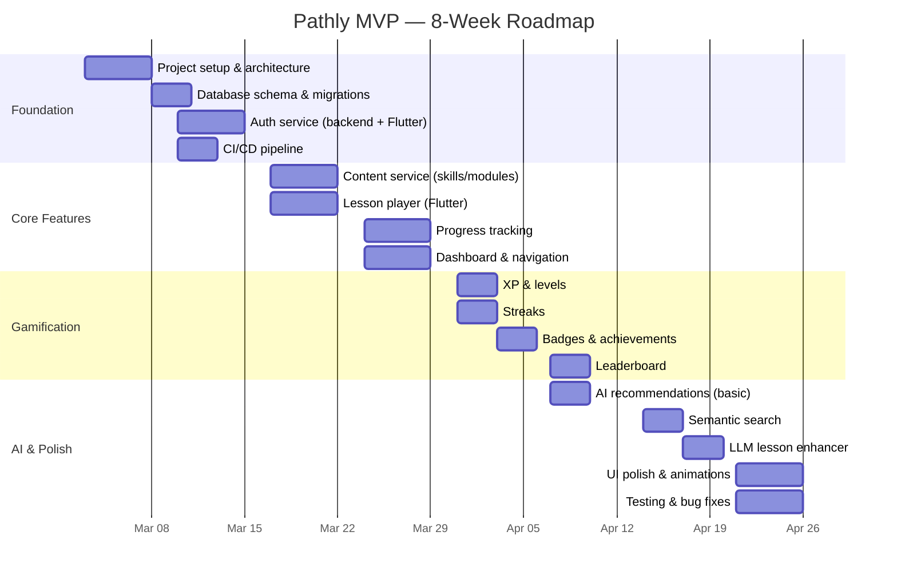

# 09 — MVP Roadmap (8-Week Plan)

> Sprint-based · Vertical Slices · Ship Week 4 · Polish Week 8

---

## Timeline Overview

---

## Week-by-Week Breakdown

### Week 1: Foundation & Setup
**Goal:** Development environment, project scaffolding, core infrastructure

| Task | Owner | Deliverable |
|---|---|---|
| Flutter project scaffold (feature-first) | Frontend | `app/` with core/, features/, shared/ |
| FastAPI project scaffold | Backend | `backend/` with domain-driven structure |
| PostgreSQL schema v1 (users, skills, modules, lessons, steps) | Backend | Alembic migration 001 |
| Docker Compose (postgres + redis + backend) | DevOps | `docker-compose.yml` |
| Design system tokens (colors, typography, spacing) | Frontend | `core/theme/` |
| CI pipeline (lint + test + build) | DevOps | `.github/workflows/ci.yml` |

**Exit Criteria:** `docker compose up` runs full stack locally; CI passes.

---

### Week 2: Authentication
**Goal:** Secure auth flow, user management, JWT tokens

| Task | Owner | Deliverable |
|---|---|---|
| Firebase Auth integration (Flutter) | Frontend | Login/register/SSO pages |
| JWT + refresh token backend | Backend | `/auth/*` endpoints |
| User profile CRUD | Backend | `/users/me` endpoints |
| Auth interceptor (Dio) | Frontend | Auto token refresh |
| Onboarding flow | Frontend | 3-screen onboarding |
| User settings page | Frontend | Timezone, display name, avatar |

**Exit Criteria:** User can register, login, see profile. JWT refresh works.

---

### Week 3: Content & Lesson Player
**Goal:** Core learning experience — browse skills, view modules, play lessons

| Task | Owner | Deliverable |
|---|---|---|
| Content API (skills, modules, lessons, steps) | Backend | Full CRUD + list endpoints |
| Skill browsing UI | Frontend | Skill grid → module list → lesson list |
| Lesson player (step-by-step) | Frontend | Text, quiz (MCQ + fill), media steps |
| Step rendering engine | Frontend | Dynamic widget for each step_type |
| Seed data script | Backend | 3 skills × 4 modules × 5 lessons |
| Content admin API (basic) | Backend | POST/PUT for skills, modules, lessons |

**Exit Criteria:** User can browse skills, open a lesson, complete steps.

---

### Week 4: Progress Tracking & Dashboard ⭐ *Internal Alpha*
**Goal:** Track completion, show progress, build dashboard

| Task | Owner | Deliverable |
|---|---|---|
| Progress service (start, step complete, finish) | Backend | `/progress/*` endpoints |
| Progress UI (skill %, module %, lesson status) | Frontend | Progress rings, completion states |
| Dashboard page | Frontend | Skill cards, continue learning, stats |
| Activity heatmap | Frontend | GitHub-style contribution graph |
| Daily goal system | Backend + Frontend | "Complete 3 lessons today" ring |
| Offline progress queue (Hive) | Frontend | Queue submissions when offline |

**Exit Criteria:** Full learning loop works: browse → learn → track. Internal demo-able.

---

### Week 5: Gamification — XP, Streaks, Badges
**Goal:** Engagement mechanics that make users come back

| Task | Owner | Deliverable |
|---|---|---|
| XP calculation engine | Backend | XP on step/lesson complete |
| Level system (threshold + title) | Backend | Level-up event, title display |
| Streak service | Backend | Daily tracking, break detection |
| Streak UI | Frontend | 🔥 streak banner, calendar view |
| Achievement rule engine | Backend | JSONB rules, event-triggered unlocks |
| Badge UI | Frontend | Badge grid, unlock animation (Rive) |
| Push notifications (streak risk) | Backend | Firebase Cloud Messaging |

**Exit Criteria:** XP flows, levels work, badges unlock, streaks tracked.

---

### Week 6: Leaderboard & Basic AI
**Goal:** Competition + first AI-powered personalization

| Task | Owner | Deliverable |
|---|---|---|
| Leaderboard service (Redis sorted sets) | Backend | Weekly/monthly/all-time |
| Leaderboard UI | Frontend | Top 100, user rank, league badges |
| Decay function (inactivity penalty) | Backend | Score formula with decay |
| Embeddings pipeline (lesson content → Qdrant) | AI | `execution/embed_content.py` |
| Basic recommendation engine | AI | Content-based filtering |
| "Recommended for you" section | Frontend | Dashboard card with AI recs |

**Exit Criteria:** Users compete on leaderboard. Basic recs show relevant content.

---

### Week 7: AI Enhancement
**Goal:** Semantic search, LLM-powered explanations, adaptive difficulty

| Task | Owner | Deliverable |
|---|---|---|
| Semantic search (Qdrant + fallback) | AI + Backend | `/search?q=...` endpoint |
| Search UI | Frontend | Search page with results |
| LLM lesson enhancer (RAG) | AI | `/ai/explain` endpoint |
| "Ask AI" button in lesson player | Frontend | Bottom sheet with AI response |
| Adaptive difficulty (basic) | AI | Mastery score → difficulty selection |
| Difficulty indicator in lesson UI | Frontend | Easy/Normal/Hard badge |

**Exit Criteria:** Search returns relevant results. AI explains concepts. Difficulty adapts.

---

### Week 8: Polish, Test, Ship 🚀
**Goal:** Production readiness — bugs, performance, UX polish

| Task | Owner | Deliverable |
|---|---|---|
| UI animations (Rive: XP gain, level up, badge unlock) | Frontend | Reward animations |
| Dark mode polish | Frontend | Full dark theme review |
| Tablet adaptive layout | Frontend | Two-pane on tablets |
| Load testing (k6, 500 concurrent) | DevOps | Performance report |
| E2E tests (integration_test/) | QA | Auth flow, lesson flow, leaderboard |
| Security audit (OWASP checklist) | Security | Penetration test report |
| Staging deployment | DevOps | `staging.pathly.app` |
| Bug bash & fix cycle | All | Zero P0/P1 bugs |
| App Store metadata prep | Product | Screenshots, descriptions |

**Exit Criteria:** App stable under load, zero critical bugs, ready for beta.

---

## MVP Feature Matrix

| Feature | MVP (Week 8) | v1.1 | v2.0 |
|---|---|---|---|
| Auth (email + Google/Apple) | ✅ | — | — |
| Skill/Module/Lesson browsing | ✅ | — | — |
| Lesson player (text, quiz, media) | ✅ | Code editor | Interactive |
| Progress tracking | ✅ | — | — |
| XP & Levels | ✅ | — | — |
| Streaks | ✅ | Streak freeze | Streak store |
| Badges | ✅ (10 badges) | 30+ badges | Custom badges |
| Leaderboard | ✅ Weekly | Leagues | Teams |
| AI Recommendations | ✅ Basic | Hybrid filtering | ML model |
| Semantic Search | ✅ | — | — |
| LLM Explainer | ✅ | Multi-turn chat | Tutor mode |
| Adaptive Difficulty | ✅ Basic | ZPD model | A/B testing |
| Offline Mode | 🔲 | ✅ | Full sync |
| Web Version | 🔲 | 🔲 | ✅ Next.js |
| Admin Panel | 🔲 | ✅ | ✅ |
| Multi-language | 🔲 | 🔲 | ✅ |
| Marketplace | 🔲 | 🔲 | ✅ |

---

## Success Metrics (MVP)

| Metric | Target |
|---|---|
| App load time | < 2s cold start |
| API p95 latency | < 200ms |
| Crash-free sessions | > 99.5% |
| Test coverage | > 80% (target 90%) |
| Lighthouse (web, future) | > 90 |
| DAU retention (D7) | > 40% |
