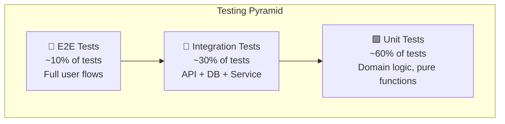

# 10 — Testing Strategy

> TDD · 90% Coverage · Unit → Integration → E2E → Load

---

## Testing Pyramid



---

## TDD Workflow

```
1. Write a failing test (RED)
2. Write minimal code to pass (GREEN)
3. Refactor with confidence (REFACTOR)
4. Repeat
```

Every PR must include tests for new functionality. CI blocks merge if coverage drops.

---

## Flutter Testing

### Unit Tests (Domain + Data Layer)
```dart
// test/features/progress/domain/usecases/complete_lesson_test.dart
void main() {
  late CompleteLesson useCase;
  late MockProgressRepository mockRepo;

  setUp(() {
    mockRepo = MockProgressRepository();
    useCase = CompleteLesson(mockRepo);
  });

  test('should return CompletionResult on success', () async {
    // Arrange
    when(() => mockRepo.completeLesson(any(), any()))
        .thenAnswer((_) async => Right(tCompletionResult));

    // Act
    final result = await useCase(CompleteLessonParams(
      lessonId: 'lesson-1',
      stepResults: [tStepResult],
    ));

    // Assert
    expect(result, Right(tCompletionResult));
    verify(() => mockRepo.completeLesson('lesson-1', [tStepResult])).called(1);
  });

  test('should return Failure when repository fails', () async {
    when(() => mockRepo.completeLesson(any(), any()))
        .thenAnswer((_) async => Left(Failure.server(code: 500)));

    final result = await useCase(CompleteLessonParams(
      lessonId: 'lesson-1',
      stepResults: [],
    ));

    expect(result.isLeft(), true);
  });
}
```

### Widget Tests
```dart
// test/features/dashboard/presentation/widgets/streak_banner_test.dart
void main() {
  testWidgets('displays current streak count', (tester) async {
    await tester.pumpWidget(
      ProviderScope(
        overrides: [streakProvider.overrideWith((_) => AsyncData(Streak(count: 7)))],
        child: MaterialApp(home: StreakBanner()),
      ),
    );

    expect(find.text('🔥 7'), findsOneWidget);
    expect(find.text('Day Streak'), findsOneWidget);
  });
}
```

### Integration Tests (Flutter)
```dart
// integration_test/lesson_completion_test.dart
void main() {
  IntegrationTestWidgetsFlutterBinding.ensureInitialized();

  testWidgets('complete a lesson and earn XP', (tester) async {
    app.main();
    await tester.pumpAndSettle();

    // Navigate to first skill
    await tester.tap(find.byKey(Key('skill-card-0')));
    await tester.pumpAndSettle();

    // Open first lesson
    await tester.tap(find.byKey(Key('lesson-item-0')));
    await tester.pumpAndSettle();

    // Complete step 1 (text)
    await tester.tap(find.text('Continue'));
    await tester.pumpAndSettle();

    // Complete step 2 (quiz)
    await tester.tap(find.text('Option A'));
    await tester.tap(find.text('Submit'));
    await tester.pumpAndSettle();

    // Verify XP animation
    expect(find.byType(XpRewardAnimation), findsOneWidget);
  });
}
```

---

## Backend Testing (Python / FastAPI)

### Unit Tests (Domain Services)
```python
# tests/unit/services/test_xp_calculator.py
import pytest
from app.services.xp_calculator import calculate_xp

class TestXPCalculation:
    def test_base_xp_for_correct_answer(self):
        result = calculate_xp(step_xp=10, correct=True, attempts=1, streak=0)
        assert result == 15  # base + first-try bonus

    def test_streak_multiplier_caps_at_7(self):
        xp_7 = calculate_xp(step_xp=10, correct=True, attempts=1, streak=7)
        xp_14 = calculate_xp(step_xp=10, correct=True, attempts=1, streak=14)
        assert xp_7 == xp_14  # Multiplier caps at 7-day

    def test_no_bonus_for_wrong_answer(self):
        result = calculate_xp(step_xp=10, correct=False, attempts=3, streak=0)
        assert result == 10  # Base only, no bonus
```

### Integration Tests (API + DB)
```python
# tests/integration/test_progress_api.py
import pytest
from httpx import AsyncClient

@pytest.mark.asyncio
async def test_complete_lesson_step(
    client: AsyncClient,
    auth_headers: dict,
    seeded_lesson: dict,
):
    response = await client.post(
        "/api/v1/progress/complete",
        json={
            "lesson_id": seeded_lesson["id"],
            "step_id": seeded_lesson["steps"][0]["id"],
            "result": {"correct": True, "time_spent_seconds": 30, "attempts": 1},
        },
        headers=auth_headers,
    )

    assert response.status_code == 200
    data = response.json()
    assert data["xp_earned"] > 0
    assert "badges_unlocked" in data

@pytest.mark.asyncio
async def test_duplicate_completion_is_idempotent(
    client: AsyncClient,
    auth_headers: dict,
    seeded_lesson: dict,
):
    payload = {
        "lesson_id": seeded_lesson["id"],
        "step_id": seeded_lesson["steps"][0]["id"],
        "result": {"correct": True, "time_spent_seconds": 30, "attempts": 1},
    }

    r1 = await client.post("/api/v1/progress/complete", json=payload, headers=auth_headers)
    r2 = await client.post("/api/v1/progress/complete", json=payload, headers=auth_headers)

    assert r1.json()["xp_earned"] > 0
    assert r2.json()["xp_earned"] == 0  # Idempotent, no double XP
```

### Contract Tests
```python
# tests/contract/test_api_schema.py
from schemathesis import from_path

schema = from_path("openapi.yaml")

@schema.parametrize()
def test_api_contract(case):
    """Auto-generated tests from OpenAPI spec."""
    response = case.call()
    case.validate_response(response)
```

---

## Load Testing (k6)

```javascript
// tests/load/lesson_flow.js
import http from 'k6/http';
import { check, sleep } from 'k6';

export const options = {
  stages: [
    { duration: '1m',  target: 100 },  // Ramp up
    { duration: '3m',  target: 500 },  // Peak load (500 concurrent)
    { duration: '1m',  target: 0 },    // Ramp down
  ],
  thresholds: {
    http_req_duration: ['p(95)<200'],   // 95th percentile < 200ms
    http_req_failed: ['rate<0.01'],     // Error rate < 1%
  },
};

const BASE_URL = __ENV.API_URL || 'https://staging.pathly.app/api/v1';

export default function () {
  // Login
  const login = http.post(`${BASE_URL}/auth/login`, JSON.stringify({
    email: `loadtest+${__VU}@pathly.app`,
    password: 'LoadTest123!',
  }), { headers: { 'Content-Type': 'application/json' } });

  check(login, { 'login 200': (r) => r.status === 200 });
  const token = login.json('access_token');
  const headers = { Authorization: `Bearer ${token}`, 'Content-Type': 'application/json' };

  // Get skills
  const skills = http.get(`${BASE_URL}/skills`, { headers });
  check(skills, { 'skills 200': (r) => r.status === 200 });

  // Get leaderboard
  const lb = http.get(`${BASE_URL}/leaderboard/weekly`, { headers });
  check(lb, { 'leaderboard 200': (r) => r.status === 200 });

  sleep(1);
}
```

---

## Coverage Targets

| Component | Target | Tool |
|---|---|---|
| Flutter (domain) | 95% | `flutter test --coverage` |
| Flutter (data) | 85% | `flutter test --coverage` |
| Flutter (presentation) | 70% | Widget tests |
| Backend (services) | 95% | `pytest --cov` |
| Backend (API) | 90% | Integration tests |
| Backend (infra) | 70% | Integration tests |
| **Overall** | **≥ 90%** | Codecov.io |

### CI Enforcement
```yaml
# codecov.yml
coverage:
  status:
    project:
      default:
        target: 90%
        threshold: 2%    # Allow 2% drop per PR
    patch:
      default:
        target: 80%      # New code must be ≥ 80% covered
```
