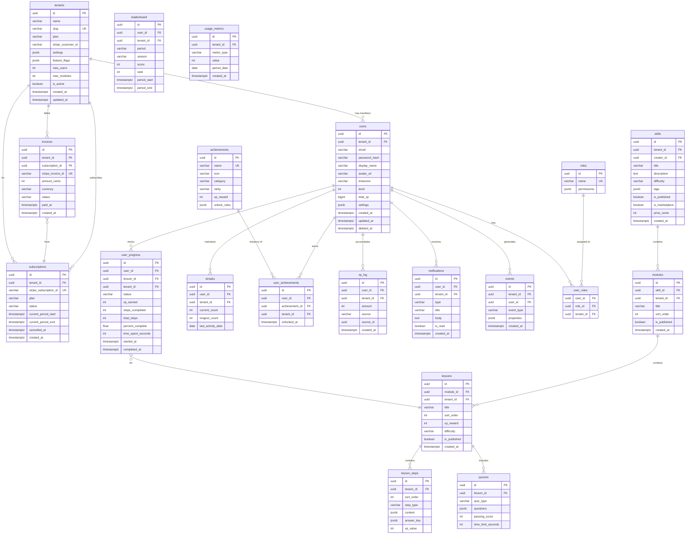

# Pathly v2 — Database Design (Enterprise SaaS)

> Multi-Tenant · Row-Level Security · Partitioned Events · Billing

---

## Entity-Relationship Diagram



---

## Key Schema Additions (DDL)

```sql
-- Row-Level Security for multi-tenancy
ALTER TABLE users ENABLE ROW LEVEL SECURITY;
CREATE POLICY tenant_isolation_users ON users
    USING (tenant_id = current_setting('app.current_tenant')::uuid);

-- Apply RLS to all tenant-scoped tables
DO $$
DECLARE t TEXT;
BEGIN
    FOR t IN SELECT unnest(ARRAY[
        'users','skills','modules','lessons','user_progress',
        'streaks','user_achievements','xp_log','events',
        'leaderboard','notifications','usage_metrics'
    ]) LOOP
        EXECUTE format('ALTER TABLE %I ENABLE ROW LEVEL SECURITY', t);
        EXECUTE format(
            'CREATE POLICY tenant_isolation_%I ON %I USING (tenant_id = current_setting(''app.current_tenant'')::uuid)',
            t, t
        );
    END LOOP;
END $$;

-- ROLES & RBAC
CREATE TABLE roles (
    id          UUID PRIMARY KEY DEFAULT gen_random_uuid(),
    name        VARCHAR(50) NOT NULL UNIQUE, -- 'learner', 'creator', 'team_admin', 'enterprise_admin', 'super_admin'
    permissions JSONB NOT NULL DEFAULT '[]'
    -- Example: ["modules.read","modules.write","users.manage","billing.view"]
);

CREATE TABLE user_roles (
    user_id     UUID NOT NULL REFERENCES users(id) ON DELETE CASCADE,
    role_id     UUID NOT NULL REFERENCES roles(id),
    tenant_id   UUID NOT NULL REFERENCES tenants(id),
    PRIMARY KEY (user_id, role_id, tenant_id)
);

-- XP LEDGER (immutable, append-only)
CREATE TABLE xp_log (
    id          UUID PRIMARY KEY DEFAULT gen_random_uuid(),
    user_id     UUID NOT NULL REFERENCES users(id),
    tenant_id   UUID NOT NULL REFERENCES tenants(id),
    amount      INT NOT NULL,
    source      VARCHAR(30) NOT NULL, -- 'lesson', 'quiz', 'streak_bonus', 'achievement', 'referral'
    source_id   UUID,
    created_at  TIMESTAMPTZ NOT NULL DEFAULT NOW()
);
CREATE INDEX idx_xp_log_user ON xp_log (user_id, created_at DESC);

-- EVENTS (partitioned by month for analytics scale)
CREATE TABLE events (
    id          UUID DEFAULT gen_random_uuid(),
    tenant_id   UUID NOT NULL,
    user_id     UUID NOT NULL,
    event_type  VARCHAR(100) NOT NULL,
    properties  JSONB DEFAULT '{}',
    created_at  TIMESTAMPTZ NOT NULL DEFAULT NOW(),
    PRIMARY KEY (id, created_at)
) PARTITION BY RANGE (created_at);

-- Create monthly partitions
CREATE TABLE events_2026_03 PARTITION OF events
    FOR VALUES FROM ('2026-03-01') TO ('2026-04-01');
CREATE TABLE events_2026_04 PARTITION OF events
    FOR VALUES FROM ('2026-04-01') TO ('2026-05-01');

-- QUIZZES
CREATE TABLE quizzes (
    id                  UUID PRIMARY KEY DEFAULT gen_random_uuid(),
    lesson_id           UUID NOT NULL REFERENCES lessons(id) ON DELETE CASCADE,
    quiz_type           VARCHAR(20) CHECK (quiz_type IN ('mcq', 'fill_blank', 'coding', 'matching', 'ordering')),
    questions           JSONB NOT NULL,
    passing_score       INT NOT NULL DEFAULT 70,
    time_limit_seconds  INT
);

-- SUBSCRIPTIONS
CREATE TABLE subscriptions (
    id                      UUID PRIMARY KEY DEFAULT gen_random_uuid(),
    tenant_id               UUID NOT NULL REFERENCES tenants(id),
    stripe_subscription_id  VARCHAR(100) UNIQUE,
    plan                    VARCHAR(30) NOT NULL,
    status                  VARCHAR(20) NOT NULL DEFAULT 'active'
                            CHECK (status IN ('trialing','active','past_due','cancelled','paused')),
    current_period_start    TIMESTAMPTZ NOT NULL,
    current_period_end      TIMESTAMPTZ NOT NULL,
    cancelled_at            TIMESTAMPTZ,
    created_at              TIMESTAMPTZ NOT NULL DEFAULT NOW()
);

-- INVOICES
CREATE TABLE invoices (
    id                  UUID PRIMARY KEY DEFAULT gen_random_uuid(),
    tenant_id           UUID NOT NULL REFERENCES tenants(id),
    subscription_id     UUID REFERENCES subscriptions(id),
    stripe_invoice_id   VARCHAR(100) UNIQUE,
    amount_cents        INT NOT NULL,
    currency            VARCHAR(3) NOT NULL DEFAULT 'usd',
    status              VARCHAR(20) NOT NULL CHECK (status IN ('draft','open','paid','void','uncollectible')),
    paid_at             TIMESTAMPTZ,
    created_at          TIMESTAMPTZ NOT NULL DEFAULT NOW()
);

-- USAGE METRICS (for metered billing + analytics)
CREATE TABLE usage_metrics (
    id          UUID PRIMARY KEY DEFAULT gen_random_uuid(),
    tenant_id   UUID NOT NULL REFERENCES tenants(id),
    metric_type VARCHAR(50) NOT NULL, -- 'active_users', 'api_calls', 'ai_tokens', 'storage_mb'
    value       INT NOT NULL,
    period_date DATE NOT NULL,
    created_at  TIMESTAMPTZ NOT NULL DEFAULT NOW(),
    UNIQUE (tenant_id, metric_type, period_date)
);

-- AUDIT LOG (compliance)
CREATE TABLE audit_log (
    id          UUID PRIMARY KEY DEFAULT gen_random_uuid(),
    tenant_id   UUID NOT NULL,
    actor_id    UUID NOT NULL,
    action      VARCHAR(100) NOT NULL,
    entity_type VARCHAR(50) NOT NULL,
    entity_id   UUID,
    old_value   JSONB,
    new_value   JSONB,
    ip_address  INET,
    user_agent  TEXT,
    created_at  TIMESTAMPTZ NOT NULL DEFAULT NOW()
) PARTITION BY RANGE (created_at);
```

---

## Indexing Strategy

| Table | Index | Type | Purpose |
|---|---|---|---|
| `users` | `(tenant_id, email)` | Unique | Login lookup per tenant |
| `user_progress` | `(tenant_id, user_id, status)` | Composite | Skill progress queries |
| `events` | `(tenant_id, event_type, created_at)` | Composite | Analytics funnels |
| `xp_log` | `(user_id, created_at DESC)` | B-tree | XP history |
| `leaderboard` | `(tenant_id, period, score DESC)` | Composite | Ranking queries |
| `subscriptions` | `(tenant_id)` | B-tree | Plan lookups |
| `notifications` | `(user_id, is_read, created_at)` WHERE `is_read = false` | Partial | Unread count |
| `audit_log` | `(tenant_id, created_at)` | Partitioned | Compliance queries |
