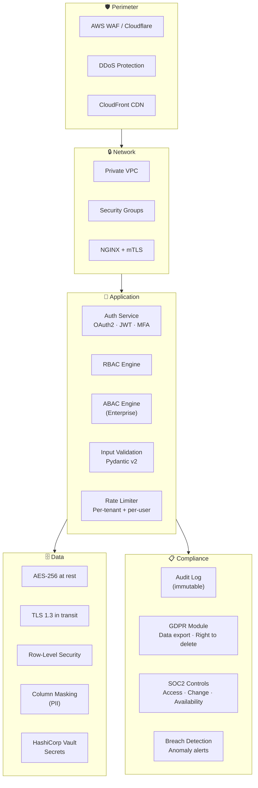

# Pathly v2 — Enterprise Security & Compliance

> SOC2 · GDPR · ABAC · Zero Trust · Audit

---

## Security Architecture



---

## Authentication (Expanded)

### Multi-Factor Auth Flow
```
Login Request
  ├── Email + Password → bcrypt verify
  ├── OAuth2 (Google / Apple / Microsoft)
  └── SAML SSO (Enterprise)
    ↓
  MFA Challenge (if enabled)
  ├── TOTP (Authenticator app)
  ├── SMS OTP (fallback)
  └── WebAuthn (future)
    ↓
  Issue JWT (access) + Refresh Token
```

### Token Architecture
```
Access Token (JWT, RS256)
├── Lifetime: 15 minutes
├── Claims: user_id, tenant_id, roles[], permissions[]
├── Audience: pathly-api
└── Issuer: auth.pathly.app

Refresh Token
├── Lifetime: 30 days
├── Storage: HTTP-only secure cookie (web) / Secure Storage (mobile)
├── Single-use with rotation
└── Revocable (stored in Redis with TTL)
```

---

## RBAC + ABAC Hybrid

### RBAC (All Plans)

| Role | Permissions |
|---|---|
| **learner** | `skills.read`, `progress.write`, `leaderboard.read` |
| **creator** | learner + `modules.create`, `modules.edit_own`, `analytics.read_own` |
| **team_admin** | learner + `users.manage_team`, `analytics.read_team`, `billing.view` |
| **enterprise_admin** | team_admin + `tenant.manage`, `sso.configure`, `audit.read`, `billing.manage` |
| **super_admin** | Everything (platform operators only) |

### ABAC (Enterprise Tier)

```python
# Attribute-Based Access Control — fine-grained policies
ABAC_POLICIES = [
    {
        "effect": "allow",
        "action": "modules.read",
        "conditions": {
            "department": {"equals": "resource.department"},  # Department-scoped
            "time": {"between": ["09:00", "18:00"]},          # Time-restricted
            "location": {"in": ["US", "IN"]},                 # Geo-fenced
        }
    },
    {
        "effect": "deny",
        "action": "data.export",
        "conditions": {
            "role": {"not": "enterprise_admin"},
            "data_classification": {"equals": "confidential"}
        }
    }
]
```

### Middleware
```python
@app.middleware("http")
async def security_middleware(request: Request, call_next):
    # 1. Rate limit check (per-tenant + per-user)
    await rate_limiter.check(request)

    # 2. JWT verification
    token = extract_token(request)
    claims = verify_jwt(token)

    # 3. Tenant resolution + RLS
    tenant_id = claims["tenant_id"]
    await db.execute(text(f"SET app.current_tenant = '{tenant_id}'"))

    # 4. RBAC check
    if not rbac.check(claims["roles"], request.method, request.path):
        raise HTTPException(403, "Forbidden")

    # 5. ABAC check (enterprise only)
    if tenant.plan == "enterprise":
        if not abac.evaluate(claims, request):
            raise HTTPException(403, "Policy denied")

    # 6. Audit log
    await audit_log.record(claims, request)

    response = await call_next(request)

    # 7. Security headers
    response.headers.update(SECURITY_HEADERS)
    return response
```

---

## GDPR Compliance Module

### Data Subject Rights API

| Endpoint | Right | Description |
|---|---|---|
| `GET /privacy/export` | Access | Export all user data as JSON/CSV |
| `DELETE /privacy/delete` | Erasure | Anonymize PII, delete optional data |
| `PATCH /privacy/consent` | Consent | Update consent preferences |
| `GET /privacy/audit` | Transparency | View processing history |

### Data Retention Policies

| Data Type | Retention | Action |
|---|---|---|
| Account data | Until deletion | Anonymize on request |
| Progress data | Until deletion | Keep anonymized for analytics |
| Analytics events | 2 years | Auto-purge |
| Audit logs | 5 years | Required for compliance |
| Payment data | 7 years | Legal requirement |
| AI conversation logs | 90 days | Auto-delete |

### Anonymization
```python
async def anonymize_user(user_id: str):
    """GDPR Right to Erasure — anonymize, don't delete (preserve referential integrity)."""
    await db.execute(
        update(users).where(users.c.id == user_id).values(
            email=f"deleted_{uuid4()}@anonymized.local",
            display_name="Deleted User",
            avatar_url=None,
            password_hash="REDACTED",
            settings={}
            deleted_at=datetime.utcnow(),
        )
    )
    # Keep progress data (anonymized) for aggregate analytics
    # Delete PII from audit logs older than retention period
```

---

## SOC2 Readiness

| Control | Implementation | Status |
|---|---|---|
| **CC1** Access Control | RBAC + ABAC, MFA, JWT rotation | 🔲 |
| **CC2** Logical Access | RLS, tenant isolation, VPC | 🔲 |
| **CC3** Risk Assessment | STRIDE threat model, quarterly reviews | 🔲 |
| **CC4** Change Management | PR reviews, CI/CD, ArgoCD GitOps | 🔲 |
| **CC5** Monitoring | Prometheus, Grafana, Sentry, ELK | 🔲 |
| **CC6** System Operations | Runbooks, incident response, PagerDuty | 🔲 |
| **CC7** Availability | K8s HPA, multi-AZ, 99.9% SLA | 🔲 |
| **CC8** Confidentiality | Encryption at rest + transit, secrets vault | 🔲 |
| **CC9** Privacy | GDPR module, data retention, consent | 🔲 |

---

## Rate Limiting Strategy

| Scope | Limit | Action |
|---|---|---|
| Free tenant | 100 req/min | 429 + retry-after |
| Pro tenant | 500 req/min | 429 + retry-after |
| Team tenant | 2,000 req/min | 429 + retry-after |
| Enterprise | Custom (SLA) | Soft limit + alert |
| Auth endpoints | 10 req/min per IP | Lockout + CAPTCHA |
| AI endpoints | Plan-based daily quota | 429 + upgrade prompt |

---

## Breach Detection Hooks

```python
ANOMALY_RULES = [
    {"rule": "failed_logins > 10 in 5min", "action": "lock_account + alert_admin"},
    {"rule": "api_calls > 10x_average in 1min", "action": "rate_limit + investigate"},
    {"rule": "data_export from new_ip", "action": "hold + verify_email"},
    {"rule": "role_change by non_super_admin", "action": "revert + alert"},
    {"rule": "bulk_delete > 100 records", "action": "soft_delete_only + audit"},
]
```
