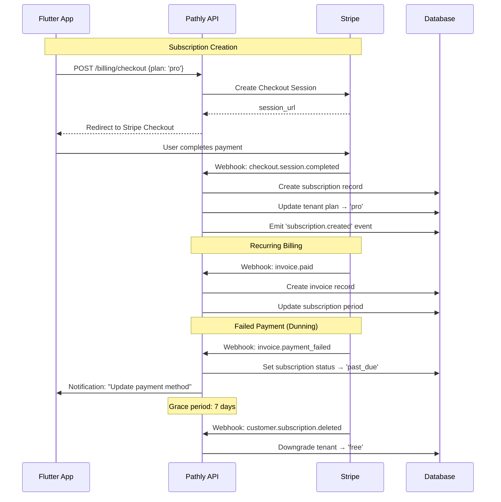

# Pathly v2 — Monetization & Pricing Engine

> Stripe · Plan Gating · Usage Metering · Creator Revenue

---

## Pricing Tiers

| Feature | Free | Pro ($9/mo) | Team ($29/mo) | Enterprise (Custom) |
|---|---|---|---|---|
| Skills access | 3 skills | Unlimited | Unlimited | Unlimited |
| Modules per skill | 2 | Unlimited | Unlimited | Custom |
| AI Tutor | 5 questions/day | 50/day | Unlimited | Unlimited + fine-tuned |
| Leaderboard | Weekly | Weekly + Monthly | Private team boards | Org-wide + dept boards |
| Offline mode | ❌ | ✅ | ✅ | ✅ |
| Team size | 1 | 1 | Up to 50 | Unlimited |
| Admin dashboard | ❌ | ❌ | ✅ Basic | ✅ Full |
| Analytics | Basic | Detailed | Team analytics | Custom dashboards |
| SSO / SAML | ❌ | ❌ | ❌ | ✅ |
| Dedicated support | ❌ | Email | Priority | Slack + CSM |
| SLA | — | — | 99.5% | 99.9% |
| Custom branding | ❌ | ❌ | Logo | Full white-label |
| Creator marketplace | Browse | Browse + Sell | Team curated | Org-curated |

---

## Stripe Integration Architecture



### Webhook Events Handled

| Event | Action |
|---|---|
| `checkout.session.completed` | Create subscription, upgrade tenant |
| `invoice.paid` | Record invoice, extend period |
| `invoice.payment_failed` | Mark past_due, send dunning email |
| `customer.subscription.updated` | Sync plan changes |
| `customer.subscription.deleted` | Downgrade to free |
| `customer.subscription.trial_will_end` | 3-day trial ending notification |

---

## Feature Gating Engine

```python
class FeatureGate:
    PLAN_LIMITS = {
        'free': {
            'max_skills': 3,
            'max_modules_per_skill': 2,
            'ai_questions_per_day': 5,
            'offline_mode': False,
            'team_size': 1,
            'admin_dashboard': False,
            'sso': False,
        },
        'pro': {
            'max_skills': None,  # Unlimited
            'max_modules_per_skill': None,
            'ai_questions_per_day': 50,
            'offline_mode': True,
            'team_size': 1,
            'admin_dashboard': False,
            'sso': False,
        },
        'team': {
            'max_skills': None,
            'max_modules_per_skill': None,
            'ai_questions_per_day': None,
            'offline_mode': True,
            'team_size': 50,
            'admin_dashboard': True,
            'sso': False,
        },
        'enterprise': {
            'max_skills': None,
            'max_modules_per_skill': None,
            'ai_questions_per_day': None,
            'offline_mode': True,
            'team_size': None,
            'admin_dashboard': True,
            'sso': True,
        },
    }

    @staticmethod
    def check(tenant: Tenant, feature: str, value: int = 1) -> bool:
        limits = FeatureGate.PLAN_LIMITS[tenant.plan]
        limit = limits.get(feature)
        if limit is None:
            return True  # Unlimited
        if isinstance(limit, bool):
            return limit
        return value <= limit
```

### Flutter-Side Feature Gating
```dart
// Check feature before rendering
if (ref.watch(featureGateProvider('offline_mode'))) {
  // Show offline download button
}

// Gate entire screen
@RoutePage()
class AdminDashboardPage extends ConsumerWidget {
  @override
  Widget build(BuildContext context, WidgetRef ref) {
    final canAccess = ref.watch(featureGateProvider('admin_dashboard'));
    if (!canAccess) return const UpgradePromptPage(feature: 'Admin Dashboard');
    return _buildDashboard();
  }
}
```

---

## Usage Metering (AI Token Costs)

```python
class UsageMeter:
    async def track_ai_usage(self, tenant_id: str, tokens_used: int, model: str):
        cost = self.calculate_cost(tokens_used, model)
        await self.db.execute(
            insert(usage_metrics).values(
                tenant_id=tenant_id,
                metric_type='ai_tokens',
                value=tokens_used,
                period_date=date.today(),
            ).on_conflict_do_update(
                index_elements=['tenant_id', 'metric_type', 'period_date'],
                set_={'value': usage_metrics.c.value + tokens_used},
            )
        )
        # Report to Stripe for metered billing (enterprise)
        if tenant.plan == 'enterprise' and tenant.metered_billing:
            await stripe.subscription_items.create_usage_record(
                tenant.stripe_si_id,
                quantity=tokens_used,
                timestamp=int(time.time()),
            )
```

---

## Creator Revenue Share

| Tier | Creator Cut | Platform Cut |
|---|---|---|
| Free module | — | — |
| Paid module | 70% | 30% |
| Top creator (>$10K) | 80% | 20% |
| Enterprise custom | Negotiable | Negotiable |

### Creator Payout Flow
```
User purchases module → Stripe processes payment
  → Platform records 30% platform fee
  → 70% held in creator balance
  → Monthly payout via Stripe Connect (>$50 threshold)
```

---

## Revenue Projections (Conservative)

| Month | Free Users | Pro | Team | Enterprise | MRR |
|---|---|---|---|---|---|
| M3 | 5,000 | 200 | 10 | 0 | $2,090 |
| M6 | 20,000 | 1,000 | 50 | 2 | $12,850 |
| M12 | 100,000 | 5,000 | 200 | 10 | $55,800 |
| M24 | 500,000 | 20,000 | 800 | 50 | $233,200 |

*Assumptions: 4% free→pro, 0.5% team, enterprise $500/mo avg*
