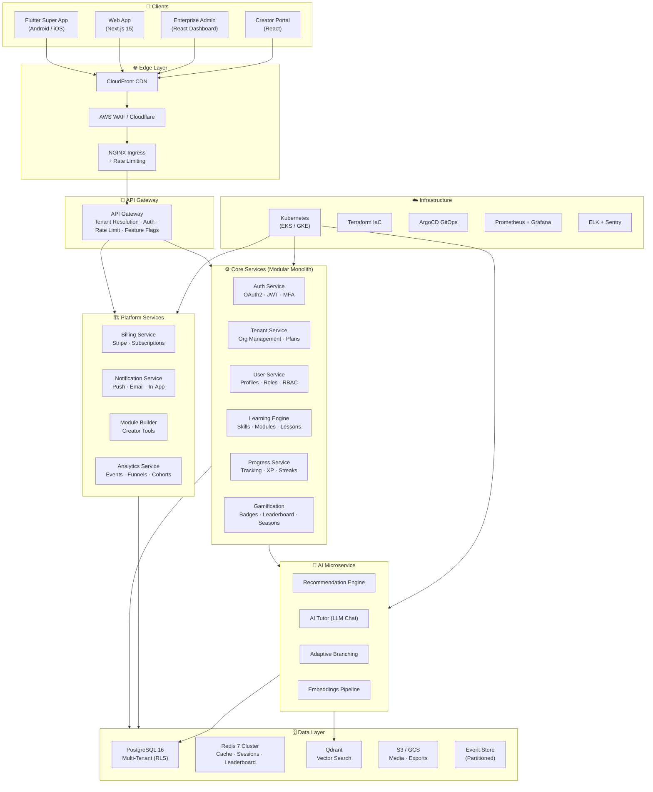
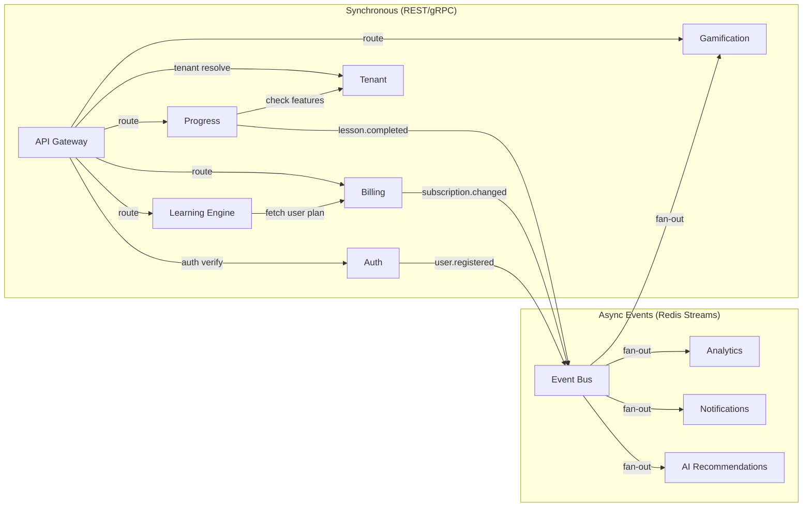
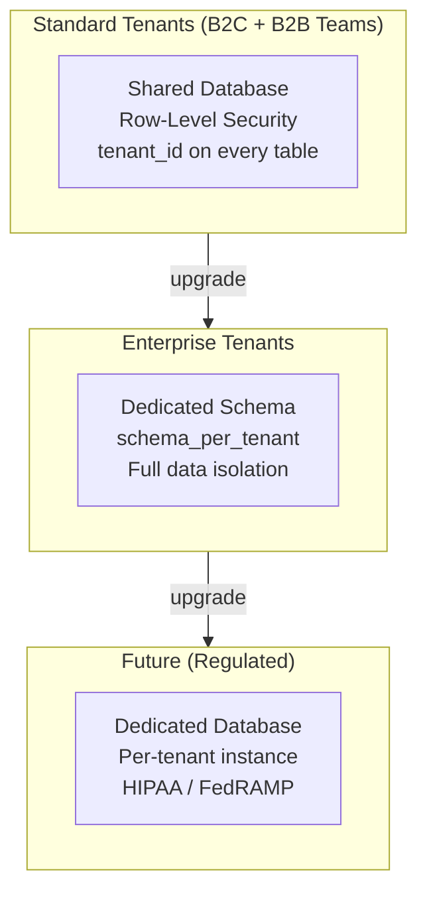

# Pathly v2 — Enterprise SaaS Architecture

> Multi-Tenant · AI-Powered · B2C + B2B · 1M+ Users · Stripe-Level Engineering

---

## High-Level Architecture



---

## Service-to-Service Interaction Map



### Event Catalog (Expanded)

| Event | Publisher | Consumers | Priority |
|---|---|---|---|
| `user.registered` | Auth | Tenant, Notification, Analytics | High |
| `lesson.completed` | Progress | Gamification, Leaderboard, Analytics, AI | High |
| `streak.broken` | Progress Worker | Notification, Leaderboard | Medium |
| `badge.unlocked` | Gamification | Notification, User | Medium |
| `subscription.created` | Billing | Tenant, Notification, Analytics | Critical |
| `subscription.cancelled` | Billing | Tenant, Notification, Analytics | Critical |
| `payment.failed` | Billing | Notification (dunning) | Critical |
| `module.published` | Builder | Learning Engine, Embeddings | Medium |
| `tenant.created` | Tenant | Auth, Billing | High |
| `ai.recommendation.served` | AI | Analytics (effectiveness tracking) | Low |

---

## Multi-Tenancy Model

### Strategy: **Hybrid — Row-Level Security (default) + Schema-per-Tenant (enterprise)**



### Tenant Resolution Flow
```
Request → API Gateway
  ├── Header: X-Tenant-ID (API clients)
  ├── Subdomain: acme.pathly.app → tenant_id
  └── JWT claim: tenant_id (mobile app)
    ↓
  Middleware sets PostgreSQL session:
    SET app.current_tenant = '{tenant_id}';
    ↓
  RLS policy:
    CREATE POLICY tenant_isolation ON users
    USING (tenant_id = current_setting('app.current_tenant')::uuid);
```

### Tenant Table
```sql
CREATE TABLE tenants (
    id              UUID PRIMARY KEY DEFAULT gen_random_uuid(),
    name            VARCHAR(200) NOT NULL,
    slug            VARCHAR(100) NOT NULL UNIQUE, -- subdomain
    plan            VARCHAR(30) NOT NULL DEFAULT 'free'
                    CHECK (plan IN ('free', 'pro', 'team', 'enterprise')),
    stripe_customer_id VARCHAR(100),
    settings        JSONB DEFAULT '{}',
    feature_flags   JSONB DEFAULT '{}',
    max_users       INT NOT NULL DEFAULT 5,
    max_modules     INT NOT NULL DEFAULT 10,
    is_active       BOOLEAN NOT NULL DEFAULT true,
    created_at      TIMESTAMPTZ NOT NULL DEFAULT NOW(),
    updated_at      TIMESTAMPTZ NOT NULL DEFAULT NOW()
);
```

---

## Architecture Decision Records (ADR)

| # | Decision | Choice | Rationale |
|---|---|---|---|
| ADR-001 | Backend Language | **Python 3.12 + FastAPI** | Best AI/ML ecosystem, async, Pydantic v2 |
| ADR-002 | Architecture | **Modular Monolith → Microservices** | Ship fast, split at scale |
| ADR-003 | Multi-Tenancy | **Hybrid RLS + Schema** | Balance cost, isolation, compliance |
| ADR-004 | Billing | **Stripe** | Industry standard, webhooks, global |
| ADR-005 | AI Infrastructure | **Separate FastAPI service** | Independent scaling, GPU-capable nodes |
| ADR-006 | Event Bus | **Redis Streams** | Simple, fast, built-in; Kafka later |
| ADR-007 | Feature Flags | **LaunchDarkly / Flagsmith** | Tenant-level + user-level targeting |
| ADR-008 | Frontend State | **Riverpod 2.x** | Type-safe, testable, code-gen |
| ADR-009 | Auth | **Firebase Auth + custom JWT** | SSO, MFA, enterprise SAML (future) |
| ADR-010 | Leaderboard | **Redis Sorted Sets + seasonal reset** | Real-time, zero-latency ranking |
