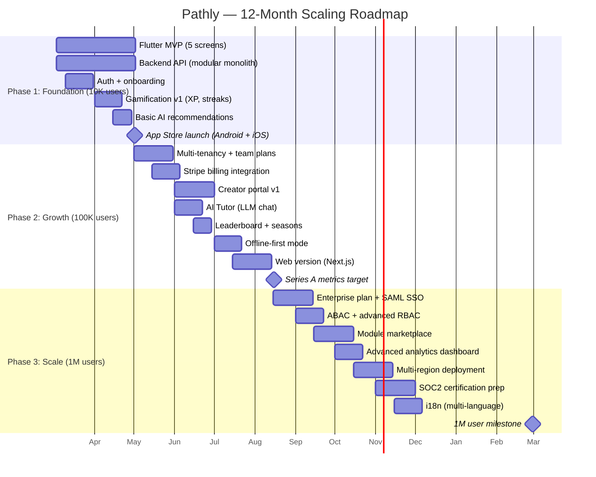

# Pathly v2 — 12-Month Scaling Roadmap

> Phase 1: 10K → Phase 2: 100K → Phase 3: 1M Users

---

## Roadmap Overview



---

## Phase 1: Foundation (Month 1–3) — Target: 10K Users

### Goals
- Ship MVP on App Store (Android + iOS)
- Core learning loop functional
- Basic gamification driving retention

### Milestones

| Week | Deliverable | Metric |
|---|---|---|
| W1-2 | Flutter project + design system + backend scaffold | Dev velocity |
| W3-4 | Auth, onboarding, content CRUD | First login |
| W5-6 | Lesson player, progress tracking | First lesson completed |
| W7-8 | XP, streaks, badges, leaderboard | D7 retention >30% |
| W9-10 | AI recommendations (basic), search | Session length |
| W11-12 | Polish, testing, App Store submission | Crash-free >99.5% |

### Infrastructure
- Single PostgreSQL instance (managed, db.t3.medium)
- Redis single node
- 2-node K8s cluster (t3.medium)
- Basic CI/CD (GitHub Actions)
- Est. cloud cost: **$200–400/mo**

---

## Phase 2: Growth (Month 4–8) — Target: 100K Users

### Goals
- Revenue engine live (Stripe)
- Team/Pro plans selling
- Creator ecosystem started
- AI Tutor MVP

### Key Features

| Month | Feature | Revenue Impact |
|---|---|---|
| M4 | Multi-tenancy + Team plans | B2B MRR starts |
| M5 | Stripe billing + Pro plan | B2C conversion |
| M5-6 | Creator portal v1 | Supply-side growth |
| M6 | AI Tutor (LLM chat) | Pro plan differentiator |
| M6-7 | Seasonal leaderboard | Engagement loop |
| M7 | Offline mode | Retention in low-connectivity |
| M7-8 | Web version (Next.js) | TAM expansion |

### Infrastructure Scale-Up
- PostgreSQL: Upgrade to db.r6g.large, read replica
- Redis: Cluster mode (3 nodes)
- K8s: 4-6 nodes, HPA auto-scaling
- CDN for all static assets
- Separate AI service on GPU-capable nodes
- Est. cloud cost: **$1,500–3,000/mo**

---

## Phase 3: Scale (Month 9–12) — Target: 1M Users

### Goals
- Enterprise customers onboarded
- SOC2 Type II in progress
- Multi-region for global users
- Marketplace generating creator revenue

### Key Features

| Month | Feature | Strategic Value |
|---|---|---|
| M9 | Enterprise plan + SAML SSO | $500+/mo contracts |
| M9-10 | ABAC + advanced admin dashboard | Enterprise table-stakes |
| M10 | Module marketplace | Creator flywheel |
| M10-11 | Advanced analytics (internal + team) | Data-driven decisions |
| M11 | Multi-region (US + EU + India) | GDPR + latency |
| M11-12 | SOC2 certification | Enterprise trust |
| M12 | Multi-language (i18n) | Global expansion |

### Infrastructure at Scale
- PostgreSQL: Multi-AZ, r6g.xlarge, 2 read replicas
- Redis: 6-node cluster, multi-AZ
- K8s: 10-20 nodes, spot instances, multi-region
- Qdrant: Dedicated cluster for AI
- Event streaming: Migrate Redis Streams → Kafka
- Est. cloud cost: **$8,000–15,000/mo**

---

## Revenue Strategy

### Revenue Model Mix

```
Year 1:
├── B2C Subscriptions (Pro)      : 60% of revenue
├── B2B Team Plans               : 25% of revenue
├── Enterprise Contracts         : 10% of revenue
└── Creator Marketplace Take     :  5% of revenue

Year 2+ Target:
├── B2B + Enterprise             : 55% of revenue  ← shift toward B2B
├── B2C Subscriptions            : 25% of revenue
├── Marketplace                  : 15% of revenue
└── API / Platform Fees          :  5% of revenue
```

### Key Business Metrics

| Metric | M3 | M6 | M12 | Target |
|---|---|---|---|---|
| Users | 5K | 50K | 500K | 1M by M18 |
| DAU | 500 | 5K | 50K | — |
| MRR | $2K | $13K | $56K | $200K by M18 |
| D7 Retention | 30% | 40% | 50% | 60% |
| LTV (Pro) | — | $80 | $120 | $200 |
| CAC | — | $15 | $10 | $8 |
| NRR (B2B) | — | — | 110% | 130% |

---

## Risk Analysis & Mitigation

| # | Risk | Impact | Probability | Mitigation |
|---|---|---|---|---|
| R1 | Low retention after onboarding | High | Medium | Gamification, streak notifications, AI-personalized paths |
| R2 | AI cost overruns (LLM tokens) | Medium | High | Token budgets per plan, caching, smaller models for simple queries |
| R3 | Stripe integration complexity | Medium | Medium | Use Stripe Checkout (hosted), start simple, iterate |
| R4 | Multi-tenancy data leak | Critical | Low | RLS, middleware isolation, automated security tests |
| R5 | Creator content quality | Medium | High | Review pipeline, user ratings, AI content scoring |
| R6 | Scale bottleneck (DB) | High | Medium | Read replicas, connection pooling (PgBouncer), query optimization |
| R7 | App Store rejection | Medium | Low | Follow platform guidelines, avoid webview-only screens |
| R8 | GDPR/compliance violation | Critical | Low | Privacy-by-design, DPO, automated data retention |
| R9 | Competitor catches up | Medium | High | AI moat, creator ecosystem, proprietary data |
| R10 | Key person dependency | High | Medium | Documentation, async-first process, modular codebase |

---

## Technical Debt Management Plan

### Principles
1. **20% rule**: Allocate 20% of each sprint to tech debt
2. **Track explicitly**: Every known shortcut goes in `TECH_DEBT.md` with severity
3. **Pay before scale**: Clear P0 debt before major scaling events

### Debt Categories

| Category | Example | When to Address |
|---|---|---|
| **P0 - Security** | Hardcoded secret, missing rate limit | Immediately |
| **P1 - Reliability** | Missing retry logic, no circuit breaker | Within 1 sprint |
| **P2 - Scalability** | N+1 queries, missing indexes, monolith coupling | Before next phase |
| **P3 - Developer Experience** | Missing types, poor error messages, no docs | Ongoing (20% time) |
| **P4 - Nice to have** | Code style inconsistency, redundant abstractions | Opportunistic |

### Scheduled Debt Paydown

| Time | Action |
|---|---|
| End of Phase 1 | Extract AI into separate service; add missing indexes |
| End of Phase 2 | Split monolith hot-paths (auth, billing); migrate to Kafka |
| End of Phase 3 | Multi-region DB; refactor creator portal; SOC2 audit fixes |
| Quarterly | "Tech Debt Week" — all hands on cleanup |

---

## Competitive Moat Strategy

| Moat Layer | Strategy |
|---|---|
| **Data Moat** | Proprietary user learning data → better AI personalization over time |
| **AI Moat** | Fine-tuned models on learning patterns → adaptive difficulty no competitor can replicate quickly |
| **Network Effects** | Creator marketplace → more content → more users → more creators |
| **Switching Cost** | Progress history, achievements, streaks — users invest time they don't want to lose |
| **Platform Lock-in** | Enterprise integrations (SSO, LMS, HR systems) → high switching cost |

---

## Terraform Infrastructure Outline

```hcl
# infra/terraform/main.tf
module "vpc"             { source = "./modules/vpc" }
module "eks"             { source = "./modules/eks"             vpc_id = module.vpc.id }
module "rds"             { source = "./modules/rds"             vpc_id = module.vpc.id }
module "elasticache"     { source = "./modules/elasticache"     vpc_id = module.vpc.id }
module "s3"              { source = "./modules/s3" }
module "cloudfront"      { source = "./modules/cloudfront"      s3_bucket = module.s3.bucket }
module "secrets_manager" { source = "./modules/secrets" }
module "monitoring"      { source = "./modules/monitoring"      cluster = module.eks.cluster }
module "waf"             { source = "./modules/waf"             cdn = module.cloudfront.id }

# Environments
module "staging" {
  source = "./environments/staging"
  providers = { aws = aws.us-east-1 }
}

module "production" {
  source = "./environments/production"
  providers = { aws = aws.us-east-1 }
}

# Future multi-region
module "production_eu" {
  source = "./environments/production"
  providers = { aws = aws.eu-west-1 }
}
```
